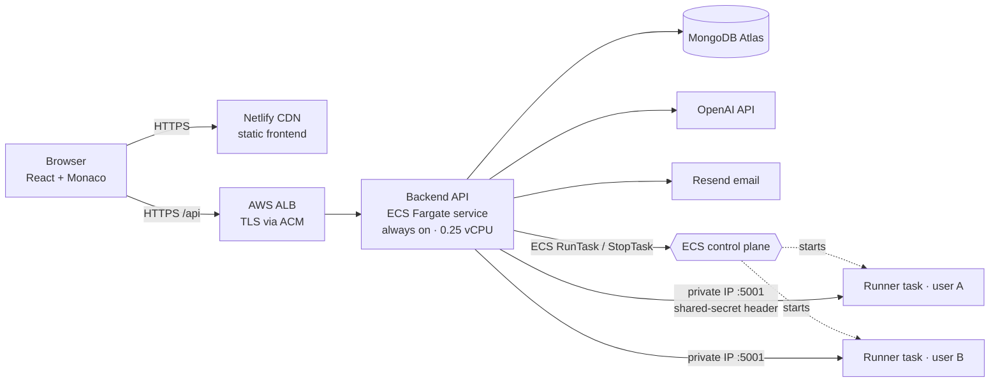
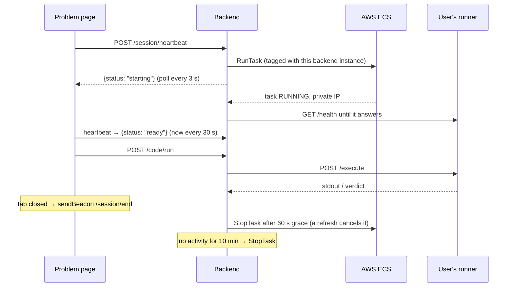

# TopCoders — Online Judge with On‑Demand Code Sandboxes

[](https://github.com/sivaprasad264842/OJ-Project/actions/workflows/ci.yml)

**Live:** [topcoders.online](https://topcoders.online) · **API:** `api.topcoders.online`

TopCoders is a full-stack competitive-programming platform (in the spirit of LeetCode). Users solve problems in C++, Java, Python or JavaScript in a browser IDE, get judged against hidden test cases, earn stars and badges, discuss problems, compete in monthly hackathons with live standings, and can ask an AI reviewer for hints.

The core engineering problem: **untrusted user code must run in isolation, and an always-on sandbox server costs money even when no one is online.** TopCoders gives every active user a **private, short-lived sandbox on AWS Fargate**. It starts when the user opens a problem and stops when they leave or go idle, so compute is billed only while someone is actually coding.

---

## Features

- **Browser IDE**: Monaco editor (the VS Code engine) with per-language drafts and custom input
- **Judge**: compiles once, runs every test case, stops at the first failure. Verdicts: Accepted / Wrong Answer / TLE / Runtime Error / Compilation Error
- **Hidden test cases**: authors mark tests hidden. Their input, expected output and even stderr never reach solvers
- **Problem set**: topic tags with counts, acceptance rates, difficulty and status filters, sorting, pagination, "pick one" random problem, and a daily problem
- **Problem authoring**: create, edit and delete problems with topic tags, visible and hidden test cases, progressive hints and an editorial (author or admin can edit)
- **Editorials**: a write-up of the intended solution, locked behind a "reveal" until you solve the problem
- **Comments**: discussion on every problem with replies, upvotes, Top/Newest sorting, editing and deleting (soft delete keeps threads readable)
- **Stars and badges**: Easy 1, Medium 2, Hard 3 stars for each first solve, awarded atomically so they can't be earned twice; six badge levels
- **Monthly hackathons**: admins schedule timed contests (with a next-month preset); users register, problems stay hidden until the start and are open only to registered users while live, live standings by points then penalty time (5 min per wrong attempt), problems become public practice after the event
- **Leaderboards**: global (stars, then problems solved) with a top-3 podium, and per-problem (accepted count, then fastest run)
- **Public profiles**: rank, stars, badges, solved by difficulty, a yearly activity calendar, recent accepted solutions and hackathon history
- **AI code review**: OpenAI explains bugs, complexity and edge cases, and gives hints rather than full answers
- **Auth**: email verification with resend, password reset by email, change password, "sign out of all devices" (token versioning revokes every JWT at once), "keep me logged in", show/hide password, strength meter, Caps Lock warning, session-expiry redirect
- **Interface**: light theme by default with an optional dark theme, full-width layout with a sidebar (daily problem, progress, next hackathon, top coders), custom TC logo, keyboard shortcuts (`/` search, `Ctrl+Enter` run, `Ctrl+Shift+Enter` submit), drafts saved per problem and language, toasts and confirm dialogs, responsive down to phone width
- **Profiles and settings**: photo upload, bio, social and resume links. Email and phone are never public
- **Admin role**: from `ADMIN_EMAILS` or the user's `role`; admins manage hackathons and can edit any problem or delete any comment

## Architecture



| Component | Where | Role |
|---|---|---|
| `Frontend/` | Netlify | React 19 SPA, Monaco editor, sandbox keep-alive hook |
| `Backend/` | ECS Fargate service (1 task) | REST API, auth, judging orchestration, **runner manager** |
| `container/` | ECS Fargate task **per active user** | Compiles and runs untrusted code with time/output/file limits |
| `deploy/` | your machine | Idempotent PowerShell scripts: account setup, secrets, build and deploy |

### Sandbox lifecycle



## Engineering highlights

- **Pay-per-use sandboxes.** One Fargate task per active user, started lazily from a heartbeat and stopped on tab close (60 s grace so a refresh reuses it), logout, or 10 min of inactivity. Heartbeats pause when the tab is hidden or the user hasn't touched the page, so a forgotten tab doesn't keep a server running.
- **Correct under concurrency.** Run + Submit clicked during a cold start trigger exactly **one** `RunTask` (the in-flight start is shared as a promise). Cold starts never hang a request: it waits up to 45 s, then returns a clear `503 RUNNER_STARTING`.
- **No leaked servers.** Every task is tagged with the launching backend's id. On boot the backend stops tasks left by crashed instances, a 5-minute reconcile loop stops untracked tasks, and each runner **exits by itself** after 15 idle minutes even if the backend is gone.
- **Cost guardrails.** `MAX_ACTIVE_RUNNERS` caps spend. Optional **Fargate Spot** cuts runner cost ~70%, and a reclaimed task is detected and replaced on the next request.
- **Infrastructure errors never become user verdicts.** If the sandbox is unavailable the API returns 503 and **stores nothing**, so a user never sees "Runtime Error" for an AWS hiccup.
- **Sandbox hardening.** Code runs as an unprivileged user in its own process group (the whole tree is killed on timeout). It gets a scrubbed environment (it can't read the service token), a capped output size, and `prlimit` file-size limits. The runner has no IAM role, accepts traffic only from the backend's security group, and can only open outbound HTTPS.
- **Least-privilege IAM.** The backend can only `RunTask` the runner task definition and only stop or describe tasks in its own cluster.
- **Secure auth.** Verification tokens are stored as SHA-256 hashes. Login compares against a dummy hash for unknown emails, so response time doesn't reveal which accounts exist. Rate limits apply per IP (auth) and per user (run/AI). The tab-close beacon carries the JWT in the body, never the URL.
- **Efficient reads.** Compound indexes for submission history, aggregation pipelines for leaderboards, and leaderboards that link to a cacheable `/avatar/:id` image instead of inlining megabytes of base64.
- **Operability.** `/health` reports DB and runner stats. Shutdown is graceful (no orphaned paid tasks). ECS deploys use a circuit breaker with automatic rollback, and images are tagged by timestamp + git SHA.

## Tech stack

| Layer | Technologies |
|---|---|
| Frontend | React 19, Vite 8, React Router 7, Monaco Editor, Axios, ESLint |
| Backend | Node.js 22, Express 5, Mongoose 9 / MongoDB Atlas, JWT, bcrypt, Helmet, express-rate-limit, AWS SDK v3 (ECS), OpenAI SDK, Resend / Nodemailer |
| Code runner | Node.js 22 + g++ (C++17), OpenJDK 17, Python 3, Node; `prlimit`; FIFO job semaphore |
| Cloud | AWS ECS Fargate (+ Spot), ECR, Application Load Balancer, ACM (TLS), SSM Parameter Store, IAM, CloudWatch Logs, VPC security groups, AWS Organizations (SCPs); Netlify; Cloudflare DNS |
| DevOps | Docker, Docker Compose, PowerShell + AWS CLI automation, GitHub Actions CI |
| Testing | `node:test` unit tests with a fake ECS client, HTTP API tests, full-stack E2E against MongoDB + the real runner image, runner smoke suite |

## Project structure

```
Backend/
  server.js               boot, graceful shutdown (stops paid runner tasks)
  app.js                  Express app: security headers, CORS, routes, errors
  services/runnerManager.js   per-user Fargate sandbox lifecycle (the core)
  services/executionService.js  calls the runner, maps failures to 503s
  controllers/            auth, problems, run, submit/judge, AI analysis, session
  middleware/             JWT auth, ownership check, rate limits, error handler
  models/                 User, PendingUser (TTL), Problem, Submission, Comment, Hackathon, HackathonRegistration
  scripts/seed.js         demo data for a local database (npm run seed)
  test/                   unit, API and end-to-end tests
container/
  server.js               runner HTTP API: /execute, /execute-batch, /ping, /health
  lib/                    languages, process sandbox, judge, semaphore
Frontend/src/
  pages/                  ProblemsPage, ProblemPage (IDE), HackathonsPage, HackathonPage, LeaderboardPage,
                          ProfilePage, SettingsPage
  components/             AppHeader, UserMenu, ProblemRow, ProblemFormModal, HackathonFormModal, Comments,
                          AccountForms, auth pages
  hooks/                  useRunnerSession (heartbeat + tab-close beacon), useAuth, useMe, useTheme, useSignOut
  ui/                     Logo, Feedback (toasts + confirm), Segmented, TagInput, Icon set, small helpers
  styles/                 theme.css design tokens, page styles
deploy/
  setup-aws.ps1           one-time AWS account bootstrap (IAM, ECR, ECS, SGs, ALB)
  create-ssm-parameters.ps1   encrypted secrets
  deploy.ps1              build, push, register task definitions, roll out
```

## Run locally

Requires Node 22+ and Docker.

```bash
# 1. Runner (sandbox) container
cd container && npm ci && npm run docker:build && npm run docker:run

# 2. Backend (new terminal)
cd Backend && npm ci && cp .env.example .env   # set MONGO_URI and JWT_SECRET
npm run seed                                   # optional: demo users, problems, comments, hackathons
npm run dev                                    # http://localhost:5000

# 3. Frontend (new terminal)
cd Frontend && npm ci && npm run dev           # http://localhost:5173
```

Without an email provider, the verification link is printed in the backend console. Or run the API and runner together with `docker compose up --build` (reads `.env` in the repo root).

## Tests

```bash
cd Backend   && npm test     # unit + API tests (E2E tests run when E2E_MONGO_URI and RUNNER_URL are set)
cd container && npm test     # runner unit tests
cd container && node test/smoke.mjs   # all languages against a running runner container
```

CI runs all of the above on every push, including the full end-to-end suite against MongoDB and the real runner image.

## Deployment

See **[DEPLOYMENT.md](DEPLOYMENT.md)**. Short version:

```powershell
.\deploy\setup-aws.ps1 -AwsProfile topcoders-new          # once per AWS account
.\deploy\create-ssm-parameters.ps1 -MongoUri "..." -ResendApiKey "..."
.\deploy\deploy.ps1                                        # every release
```

## API overview

| Method | Path | Auth | Purpose |
|---|---|---|---|
| POST | `/api/auth/register` · `/login` | – | Sign up (email verification) / get JWT |
| GET | `/api/auth/verify/:token` | – | Verify email (single use, 30 min) |
| POST | `/api/auth/resend-verification` | – | New verification link |
| POST | `/api/auth/forgot-password` · `/reset-password` | – | Email a reset link / set a new password (signs out every device) |
| PUT | `/api/auth/password` | JWT | Change password (other devices signed out) |
| POST | `/api/auth/logout-all` | JWT | Sign out of all devices |
| GET/PUT | `/api/auth/me` | JWT | Own profile |
| GET | `/api/auth/leaderboard` · `/avatar/:userId` | – | Global ranking / profile photo |
| GET | `/api/problems/all` · `/:id` | optional | List with acceptance stats / view (editors also see hidden tests) |
| GET | `/api/problems/tags` · `/daily` | – | Topic tags with counts / problem of the day |
| GET/POST | `/api/problems/:id/comments` | optional / JWT | List threads (Top or Newest) / comment or reply |
| PUT/DELETE | `/api/comments/:id` | JWT + author (admin may delete) | Edit / delete a comment |
| POST | `/api/comments/:id/vote` | JWT | Toggle upvote |
| GET | `/api/hackathons` · `/:slug` · `/:slug/standings` | optional | List / details / live standings |
| POST/DELETE | `/api/hackathons/:slug/register` | JWT | Register / unregister (before start) |
| POST/PUT/DELETE | `/api/hackathons` · `/:slug` | admin | Schedule / edit / delete a hackathon |
| GET | `/api/users/:username` | – | Public profile: stars, badges, calendar, recent solves |
| POST/PUT/DELETE | `/api/problems/create` · `/:id` | JWT + owner | Author problems |
| POST | `/api/code/run` · `/submit` | JWT | Run on custom input / judge a submission |
| POST | `/api/code/analyze` | JWT | AI review |
| GET | `/api/code/submissions/me` · `/leaderboard/problem/:id` | JWT / – | History / per-problem ranking |
| POST | `/api/session/heartbeat` · `/end` | JWT | Start/keep or release the user's sandbox |

## Roadmap

- Move runner sessions to Redis/DynamoDB so the API can run more than one instance
- Stronger isolation for untrusted code (gVisor / Firecracker microVMs, no outbound network)
- Warm pool of 1–2 pre-started runners to remove the ~30–60 s cold start
- Push standings over WebSockets instead of 30-second polling
- Problem lists (study plans), bookmarks and solution sharing
- Infrastructure as code (Terraform / AWS CDK) instead of scripts
